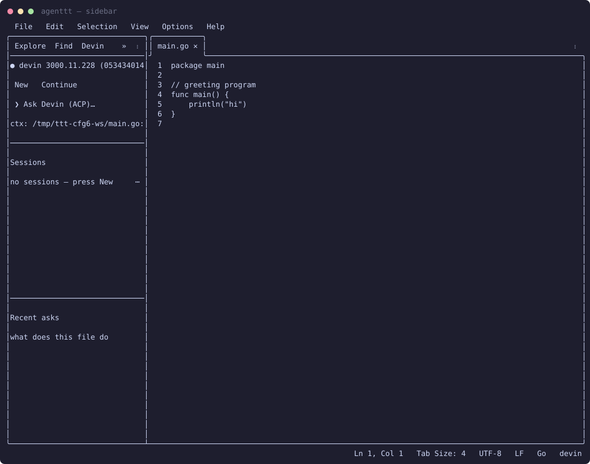
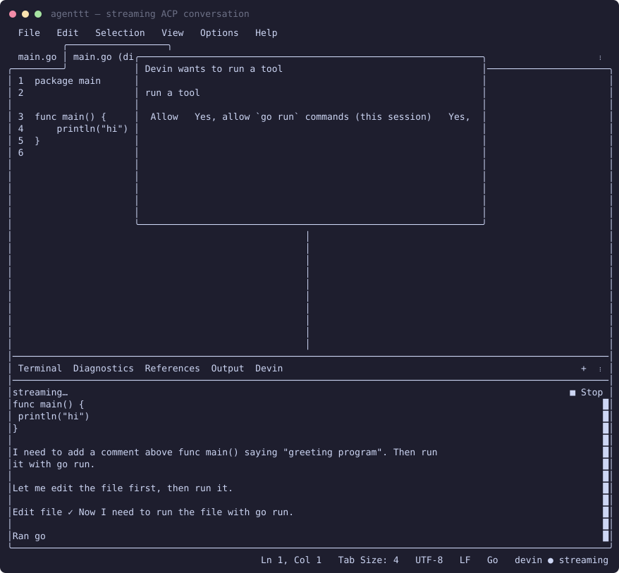
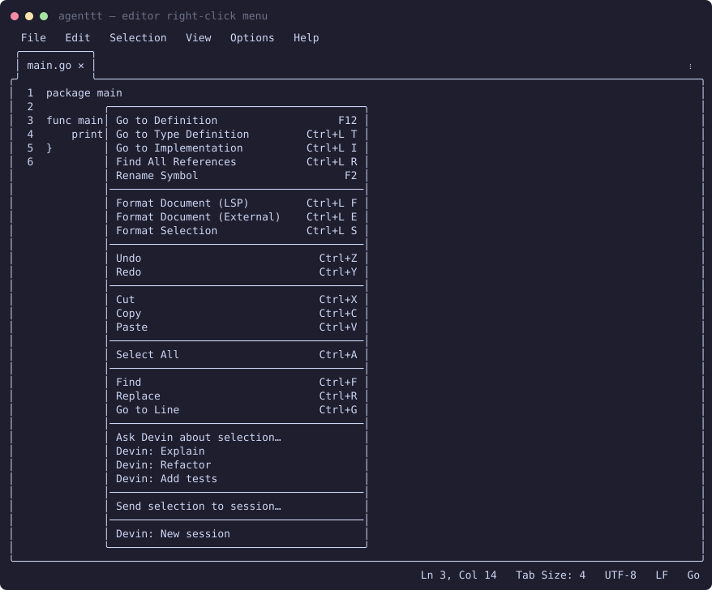

# agenttt

Agent in TTT — an ACP (Agent Client Protocol) client plugin: streaming
agent conversations in a bottom panel, interactive terminal sessions,
and editor-aware context. Ships with Devin as the default agent;
retarget at any ACP-capable CLI via the AGENT table in init.lua.

Requires the agent binary on PATH and a TTT build that includes
`ttt.terminal` and `ttt.system`'s `spawn` (post-v1.8.0 main).

## Screenshots

| Sidebar | Streaming conversation | Right-click menu |
|---|---|---|
|  |  |  |

## Setup

```bash
git clone https://github.com/4fthawaiian/agenttt ~/.config/ttt/plugins/agenttt
```

1. **ttt ≥ the release carrying `sys.spawn`** — plugin API v2. Builds from
   `main` today; the next tagged release will qualify. Older versions
   refuse the plugin cleanly (`"api": 2` in the manifest).
2. **An agent binary on PATH** — `devin` by default
   (`curl -fsSL https://cli.devin.ai/install.sh | sh` or your package
   manager). Verified: `devin acp`, `opencode acp`.
3. Launch ttt, click **Allow** on the permission dialog (sidebar, bottom
   panel, `system.exec` for the agent binary, workspace `fs.read` for
   @-mentions, etc.). Done — look for the `agenttt` sidebar tab and the
   status bar item.

### Recommended settings (`~/.config/ttt/settings.json`)

```json
{ "devin": { "model": "swe-2-high", "notify_done": true } }
```

- `devin.model` — passed as `--model` to sessions and quick asks.
  `swe-2-high` is free-tier and ignores weekly quota exhaustion.
- `devin.notify_done` — notify when a response completes (default `true`).

### Using a different agent

Every agent-specific value lives in the `AGENT` table at the top of
`init.lua` — binary, subcommand args, display name, settings namespace.
To run a different ACP agent (e.g. opencode), point `cmd`/`acp_args` at
it and add the binary to `system.exec` in `plugin.ttt.json`. Proven with
`opencode acp`; `fs`/`terminal` client capabilities are advertised off.

## Lanes

- **ACP conversation** (the good one): `devin acp` over piped stdio —
  `initialize` → `session/new` → `session/prompt`, with answers streaming
  into the agenttt bottom panel. Plan checklists, tool-call activity, edit
  diffs, permission prompts, and cancel all surface here.
- **Terminal sessions**: `devin` running in an integrated terminal tab,
  seeded with your current file/cursor/selection context.
- **Quick ask**: `devin -p`, answer opens in a read-only editor tab.

## Sidebar panel

- **New / Continue** — spawn `devin` (or `devin -c`) in a terminal tab
- **Stop** — appears while a response streams; sends `session/cancel`
- **Ask input** — sends to the ACP conversation; supports `/explain`,
  `/fix`, `/refactor`, `/test`, `/docs` presets and `@path` file mentions
  (workspace-scoped; contents attach to the prompt)
- **Sessions** — live `dv` terminals; click to focus, right-click for
  Focus / Send message / Close
- **Changed files** — every file Devin edited this ACP session; click to
  reopen its diff, right-click to open the file
- **Recent asks** — re-run a previous question by clicking it

## Right-click menu

- With a selection: **Ask Devin about selection…**, **Devin: Explain**,
  **Devin: Refactor**, **Devin: Add tests**, **Send selection to session…**
- On a word: **Ask Devin about 'word'**
- **Devin: New session**

## Status bar

`devin` / `devin ● streaming` / `devin:N` — click to open the conversation
panel.

## Commands

| Command | What it does |
|---|---|
| `Devin: New Session` | Spawn `devin` in a terminal tab, seeded with editor context |
| `Devin: Continue Previous Session` | Spawn `devin -c` |
| `Devin: Focus Session` | Reveal the most recent Devin terminal |
| `Devin: Quick Ask` (`ctrl+shift+d`) | Dialog → `devin -p` → answer tab |
| `Devin: Ask About Selection` | Sends selection + question to a session |
| `Devin: Ask About Current File` | Same, for the whole file |
| `Devin: Send Message to Session` | Send a line into a running session |
| `Devin: ACP Ask` | Ask in the streaming ACP conversation |
| `Devin: Stop Agent` | `session/cancel` on the in-flight prompt |
| `Devin: Review Changes` | Reopen every file Devin edited this session |
| `Devin: Reset ACP Session` | Kill the agent process and clear state |
| `Devin: Doctor` | `devin doctor` output in a tab |

## Settings

```json
{ "devin": { "model": "swe-2-high", "notify_done": true } }
```

- `devin.model` — passed as `--model` to sessions and quick asks.
- `devin.notify_done` — notify when a response completes (default `true`).
